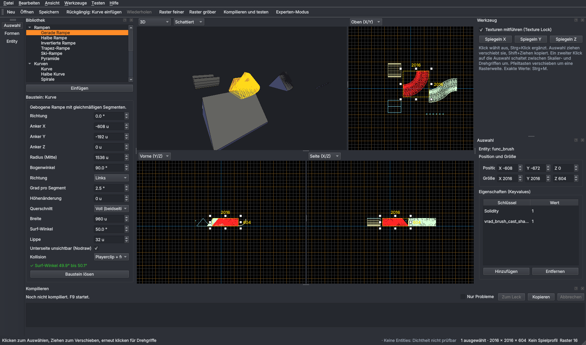

# Rampenschmiede

Desktop-Map-Editor für Windows, spezialisiert auf Surf-, Bhop- und Trick-Maps für
Counter-Strike: Source und Momentum Mod. Ziel: Ein Anfänger baut in 30 Minuten eine
spielbare Surf-Map, ein Profi vermisst keine Funktion aus Hammer.

> **Stand: Etappe 7 von 11** – Fenster, 3D- und 2D-Ansichten, Grundformen, Auswählen,
> Verschieben, Drehen, Skalieren, Undo/Redo, Speichern als `.rsmap`, VMF-Import und -Export
> ohne Verluste, Kompilieren und Testen mit einem Tastendruck (F9) für CS:S und Momentum Mod,
> Startraum mit Dicht-Prüfung, Rampen-Bibliothek mit 20 Vorlagen, deren Regler sich jederzeit
> ändern lassen, eigene Prefabs und der Assistent „Neue Surf-Map“, Texturen und Welt-Stile,
> Entities mit FGD-Feldern und I/O, BSPs öffnen, Licht-Vorschau und Himmel, Props mit Modell-Browser,
> Gelände (Displacements) mit Pinsel und Vorlagen, Props streuen mit Detail-Kits.



## Installation

### Fertige .exe (empfohlen)

Jeder Push baut über GitHub Actions eine Windows-Version:
**Actions → „Tests und Windows-Build“ → letzter Lauf → Artefakt `Rampenschmiede-Windows`**.
ZIP entpacken und `Rampenschmiede.exe` starten. Benötigt eine Grafikkarte mit OpenGL 3.3
(jede GPU der letzten zehn Jahre).

### Aus dem Quellcode

Voraussetzung: Python 3.12.

```powershell
git clone https://github.com/flavyopolo-a11y/rampforger
cd rampforger
py -3.12 -m venv .venv
.venv\Scripts\activate
pip install -e .[dev]
python -m rampenschmiede            # optional: Pfad zu einer .rsmap-Datei
```

Tests: `pytest` · eigene .exe bauen: `python packaging/build_exe.py` (Ergebnis in `dist/Rampenschmiede`).

## Bedienung

Die Steuerung folgt Hammer, damit Umsteiger sich sofort zurechtfinden. **F1** zeigt alle Tasten.

**Ansichten.** Vier Ansichten: 3D, Oben (X/Y), Vorne (Y/Z), Seite (X/Z). Jede lässt sich über
ihre Kopfzeile umstellen, die Trenner sind verschiebbar. Die Ansicht unter der Maus ist orange
umrandet. Die 3D-Ansicht kennt die Modi Texturiert, Schattiert, Flach und Drahtgitter.

**Werkzeuge.** Links stehen die Werkzeuge mit Symbol (Auswahl, Malen, Formen, Entity, Seiten,
Schneiden, Loch, Ecken, Wände, Gelände, Streuen, Messen). Das aktive
ist orange hinterlegt, oben rechts steht zusätzlich „Werkzeug: …“.

| Kamera | |
| --- | --- |
| Rechte Maustaste halten (3D) | Umsehen, dazu W A S D fliegen, Q/E runter/hoch, Shift schneller |
| Z (3D) | Umsehen ein/aus |
| Mausrad | 3D: vor/zurück · 2D: zoomen zum Mauszeiger |
| Mittlere Maustaste oder Leertaste + Ziehen | Ansicht verschieben |
| Strg+E | alle Ansichten auf die Auswahl zentrieren |

**Formen bauen (Shift+B).** Form wählen (Block, Keil, Zylinder, Bogen, Treppe, Spitze, Kugel, Torus): links in der
Bibliothek unter *Formen* oder rechts als Bild. In einer 2D-Ansicht einen Rahmen aufziehen, in einer zweiten Ansicht die Höhe anpassen, **Enter**.
Schneller: in der 3D-Ansicht auf eine Fläche klicken, der Rahmen sitzt dann direkt darauf.
Eine Form aus der Bibliothek in eine Ansicht ziehen setzt sie in der zuletzt benutzten Größe ab.

**Rampen malen (Shift+R).** Vorlage links in der Bibliothek anklicken, Regler nach Wunsch stellen,
dann in einer Ansicht vom Anfang zum Ende der Rampe ziehen. Die Vorschau hängt am Mauszeiger,
beim Loslassen wird gebaut. Der Strich bestimmt Länge und Richtung, bei Kurven Radius und
Richtung. Ein Klick ohne Ziehen setzt die Vorlage so ab, wie sie ist. Esc beendet das Malen.

**Wände malen (Shift+K).** In „Oben“ oder in 3D Punkte klicken: Daraus werden Wände, die an den
Ecken auf Gehrung sauber aneinanderstoßen. Klick auf den ersten Punkt schließt den Raum, Enter
beendet. Höhe, Dicke und Unterkante rechts unter Werkzeug; in 3D setzt der erste Klick die
Unterkante. Die Wände sind eine Gruppe.

**Stützen unter Rampen.** Rampe auswählen, in der Bibliothek „Stützen bis zum Boden“ anhaken:
Pfeiler im gewählten Abstand reichen bis zum nächsten Brush darunter und passen sich an, wenn die
Rampe verschoben oder geändert wird.

**Startzone auf dem Startblock.** Neue Maps beginnen mit einem Startblock, auf dem die Startzone
sitzt. Zonen aus der Bibliothek setzen sich auf den Block unter dem Mauszeiger. Wird der Block
verschoben oder größer gezogen, wandert die Zone mit.

**In 3D direkt ziehen.** Ein Objekt in der 3D-Ansicht anfassen und ziehen schiebt es waagrecht am
Raster, Shift kopiert. Hoch und runter über den blauen Pfeil.

**Aufkleber (Shift+T).** Material im Browser wählen und in 3D auf eine Fläche klicken; ein Rahmen
zeigt vorher, wo er landet. *Overlay* (Standard) hat eine einstellbare Größe und nimmt jedes
Material, auch Wandtexturen für Wege oder Schilder; über mehrere Brushes in derselben Ebene klebt
es auf alle und wandert beim Verschieben mit. *Decal* nimmt ein Bild aus `decals/` in
Originalgröße (Graffiti, Risse). „Probleme suchen“ meldet Overlays, unter denen keine Fläche mehr ist.

**Bereich / Cordon (Shift+O).** In einer 2D-Ansicht ein Rechteck um den Teil ziehen, an dem du
gerade baust: Beim Kompilieren wird nur er gebaut und automatisch mit Skybox abgedichtet, das geht
bei großen Maps viel schneller. Kanten ziehen ändert die Größe, innen ziehen verschiebt, Entf
löscht. *Testen → Nur Bereich bauen* schaltet ihn an und aus, *Bereich = Auswahl* legt ihn um die
Auswahl. Der rote Rahmen zeigt in allen Ansichten, dass er aktiv ist. Die Map selbst bleibt
unverändert, die 3D-Skybox wird immer mitgebaut.

**3D-Skybox (Texturen → 3D-Skybox).** Ein Klick legt unter der Map einen abgedichteten Raum mit
`sky_camera` an und baut darin eine Kulisse: Berge, Stadt oder Dünen (oder leer, zum Selberbauen).
Im Spiel erscheint sie 16-mal so groß rings um die Map hinter dem Himmel, im Nebel der Map. Ein
neuer Klick ersetzt sie, dort lässt sie sich auch entfernen. Die mitwachsende Hülle lässt den
Raum außen vor.

**Natur (Bibliothek → Natur).** *Wasser* ist echtes Source-Wasser (Spiegelung, Schwimmen): Unterkante
auf den Boden legen, Länge, Breite und Tiefe per Regler; „Tod im Wasser“ macht eine Todesfalle
daraus. *Lava* leuchtet von selbst und tötet bei Berührung. *Kill-Zone (Grube)* legt man unten in
Gruben und Abgründe: Wer hineinfällt, stirbt oder landet wieder am Start (das Teleport-Ziel wird
in der Startzone angelegt). *Baum*, *Busch*, *Palme* und *Felsen* setzen ein zufälliges passendes
Modell aus dem Spiel, jeder Klick ein anderes. Wasser und Lava sind Welt-Brushes (nur so zeigt
Source Wasser); ihr Trigger hängt als Gruppe daran.

**Automatische Sicherung.** Alle 5 Minuten wird eine geänderte Map in den Ordner `sicherungen` im
Datenordner geschrieben (je Map die letzten 10), und vor jedem Speichern landet die alte Fassung
dort (die letzten 5). *Datei → Sicherung öffnen* zeigt den Ordner. Stürzt das Programm ab, bietet
es beim nächsten Start die neueste Sicherung an. Abschalten unter *Datei → Automatisch sichern*.

**Ecken (Shift+V).** Brush auswählen, Werkzeug „Ecken“: Weiße Griffe sind Ecken, gelbe die Mitten
der Kanten. Ziehen verformt den Brush, eine Kantenmitte zieht beide Ecken. Strg+Klick oder ein
Rahmen wählt mehrere Ecken, Pfeiltasten schieben sie um eine Rasterweite, in 3D hebt Shift+Ziehen
senkrecht. Der Brush bleibt konvex und ganzzahlig; was ihn hohl machen würde, wird abgelehnt.
Fallen zwei Ecken zusammen, verschmelzen sie (so entstehen Keile und Spitzen).

**Ordnen wie in Hammer (Menü Bearbeiten).**

| Taste | |
| --- | --- |
| Strg+G / Strg+U | Gruppieren / Gruppe auflösen. Ein Klick auf ein Mitglied wählt die ganze Gruppe |
| Strg+W | Gruppen ignorieren (einzelne Objekte wählen) |
| Strg+T | An Entity binden: Brushes werden `func_detail`, Trigger, Tür …; Trigger bekommen die Trigger-Textur |
| Strg+Shift+W | Zur Welt: Brushes aus ihrer Entity lösen |
| Strg+Shift+V | Mehrfach kopieren: Anzahl, Versatz und Drehung je Kopie (Treppen, Säulenreihen, Wendel) |
| Strg+B | Auswahl ans Raster legen |

Gruppen bleiben im VMF als Hammer-Gruppen erhalten.

**Schneiden (Shift+X), Loch (Shift+L), Aushöhlen (Strg+Shift+C).** Schneiden: Brushes auswählen,
in einer 2D-Ansicht eine Linie ziehen; Tab wechselt, welche Seite bleibt (beide, hinten, vorne),
Enter schneidet. Loch: Brushes auswählen, in einer 2D-Ansicht ein Rechteck aufziehen, Enter
schneidet ein Loch oder Fenster ganz hindurch. Aushöhlen: Der gewählte Brush schneidet sich aus
allen Brushes heraus, die er berührt, wie Carve in Hammer. Rampen-Bausteine werden nicht
geschnitten; dafür vorher *Baustein lösen*.

**Auswählen und Bearbeiten (Shift+S).** Klick wählt aus, Strg+Klick ergänzt, Ziehen auf
leerer Fläche zieht einen Auswahlrahmen auf. Auswahl ziehen verschiebt am Raster, Shift+Ziehen
kopiert. Die weißen Griffe skalieren; ein zweiter Klick auf die Auswahl schaltet auf Drehgriffe
(15°-Schritte, mit Shift frei). Pfeiltasten verschieben um eine Rasterweite.
In der 3D-Ansicht hat die Auswahl drei Pfeile (X rot, Y grün, Z blau): einen Pfeil greifen und
ziehen verschiebt nur entlang dieser Achse, am Raster. Shift beim Greifen verschiebt eine Kopie.
Am orangen Ring um die Auswahl dreht man sie um die Hochachse (15°-Schritte, mit Shift frei);
Rampen bleiben dabei Bausteine mit Reglern.
Exakte Zahlen: Panel „Auswahl“ oder **Strg+M** (Transformieren).

**Entities (Shift+E).** Schnellauswahl für Spawns (CT, T, Momentum), Punkt-, Spot- und Sonnenlicht,
Cubemap und Teleport-Ziel; über *Suche* jede andere Entity aus den FGD-Daten (eingebaut für CS:S
und die anderen Source-Spiele, dazu die FGD-Dateien aus dem Spielprofil, z. B. von Momentum).
Neue Entities bekommen die Standardwerte ihrer Klasse.

**Auswahl (Panel links unter der Szene).** Oben steht, was ausgewählt ist („Rampe“, „Brush“,
„Licht“, „Trigger“ …), darunter Position und Größe zum Eintippen. Wer in den Ansichten etwas
anklickt, sieht es links in der Szenen-Liste markiert (der Ordner klappt auf). Bei Rampen bleibt
die Bibliothek vorn, weil dort ihre Regler stehen.

**Entity-Eigenschaften (Panel „Auswahl“).** Klasse wählen oder tippen, darunter drei Reiter:
*Eigenschaften* mit passenden Feldern (Auswahllisten, Häkchen, Farbwähler mit Helligkeit für
Lichter, Namensliste für Ziele, Hilfetext beim Überfahren), Flags als Liste zum Abhaken und
unbekannte Keys als Text. *Ausgänge* zeigt alle I/O-Verbindungen: Ausgang, Ziel, Eingang (die
Liste passt sich der Zielklasse an), Parameter, Verzögerung und „nur einmal“; Ziele, die es in der
Map nicht gibt, sind rot. *Eingänge* listet, wer diese Entity anspricht, Doppelklick springt hin.
Bei gewählten Entities zeigen Linien in den Ansichten ihre Verbindungen: grün zu den Zielen,
orange von den Auslösern.

**Licht.** In der 3D-Ansicht oben links *Licht-Vorschau* wählen: Die Map wird so beleuchtet, wie
vrad rechnet (Helligkeit bei 100 Units, Abfall konstant/linear/quadratisch oder 50-%-/0-%-Abstand,
Spot-Kegel innen/außen, Sonne mit Umgebungslicht), nur ohne Schatten und Lichtreflexe. Hat die Map
gar kein Licht, ist sie hell wie im Spiel (fullbright). Ein ausgewähltes Licht zeigt seine
Reichweite als Kugel, ein Spot seinen Kegel, die Sonne einen Pfeil in Leuchtrichtung. Die Kästchen
der Lichter haben ihre Lichtfarbe. Spot und Sonne lassen sich direkt ausrichten: in der 3D-Ansicht
dorthin schauen, wohin das Licht soll, und im Panel *In Blickrichtung der 3D-Kamera ausrichten*.

**Himmel (Texturen → Himmel).** Alle Skyboxen des Spiels mit Bild zum Aussuchen. In *Texturiert*
und *Licht-Vorschau* zeigt die 3D-Ansicht den Himmel im Hintergrund und auf allen Skybox-Flächen,
so wie im Spiel. **Cubemaps:** `env_cubemap` setzen (Entity-Werkzeug), dann im Kompilier-Dialog
*Cubemaps bauen* anhaken. Das Spiel startet mit `-buildcubemaps`, baut die Spiegelungen in die BSP
und schließt sich; danach normal starten.

**Props (Reiter „Modelle“ unten).** Alle Modelle des Spiels als Bildchen, mit Suche und Ordnern
(„In dieser Map“ zeigt, was schon verwendet wird). Rechts eine Vorschau, die sich mit der Maus
drehen lässt, dazu Größe, Skins und was das Modell kann. Ein Modell in eine Ansicht ziehen setzt
es dort als Prop, *In Map setzen* setzt es in die Mitte. Die Prop-Art wählt Rampenschmiede
passend: **Statisch**, wenn das Modell dafür gebaut ist (am günstigsten im Spiel), sonst
**Dynamisch**. Im Auswahl-Panel lässt sie sich mit drei Knöpfen wechseln; passt sie nicht zum
Modell (statisch mit einem dynamischen Modell löscht vbsp, Physik ohne Kollisionsmodell erscheint
nicht), steht dort warum, und vor dem Kompilieren kommt eine Warnung ins Log. Sind Props
ausgewählt, tauscht *Für Auswahl übernehmen* (oder Doppelklick) ihr Modell. Props erscheinen in
3D texturiert und gedreht, in 2D als Umriss, auch in geöffneten BSPs.

**Gelände (Werkzeug „Gelände“, Shift+G).** Brushes auswählen und *Zu Gelände machen*: ihre
Oberseite wird ein Displacement (4 × 4, 8 × 8 oder 16 × 16 Felder). Darüber ziehen formt es, in 3D
oder von oben: *Heben*, *Senken*, *Glätten*, *Rauschen*, *Ebnen*. Shift kehrt um, [ und ]
ändern die Pinselgröße, ein Strich ist ein Rückgängig-Schritt. *Textur malen* blendet bei
Überblend-Materialien (zwei Texturen, z. B. `nature/blendgrassgravel001a`) zur zweiten Textur
über, wie im Spiel. Nach jedem Strich werden die Nähte zu benachbarten Gelände-Flächen
geschlossen, damit keine Lücken entstehen. Fertige Formen stehen in der Bibliothek unter
**Gelände**: Hügel, Berg, Felsen, Insel und Klippe, in Kacheln bis 1024 Units, an steilen
Stellen schon mit der zweiten Textur. Gelände dichtet die Map nicht ab (wie in vbsp); darunter
muss die Hülle geschlossen bleiben.

**Props streuen (Werkzeug „Streuen“, Shift+D).** Klicken oder ziehen verteilt Props zufällig im
Kreis auf Boden und Gelände, mit Mindestabstand und zufälliger Drehung; zu steile Stellen (Wände,
Surf-Rampen) bleiben frei. Gestreut wird das Modell aus dem Modell-Browser oder ein
**Detail-Kit**: Wald und Wiese, Felsen und Geröll, Wüste, Industrie, Stadt. Ein Kit nimmt die
passenden Modelle, die es im Spiel gibt (einzelne lassen sich abwählen); nach einem Welt-Stil ist
das passende Kit vorgewählt. Felsen kippen mit dem Hang, Bäume bleiben aufrecht. Shift entfernt
die Props dieser Modelle im Kreis.

| Weitere Tasten | |
| --- | --- |
| [ / ] | Raster feiner / gröber (1 bis 512) |
| Strg+Z / Strg+Y | Rückgängig / Wiederholen (unbegrenzt) |
| Strg+C / Strg+V / Strg+X / Entf | Kopieren / Einfügen / Ausschneiden / Löschen |
| Strg+L / Strg+I | Spiegeln horizontal / vertikal |
| H / Strg+H / U | Auswahl ausblenden / Rest ausblenden / alles einblenden |
| Strg+S | Speichern als `.rsmap` |
| Strg+Shift+E | Als `.vmf` exportieren |

**Startraum.** Jede neue Map beginnt mit einem Spawn (für CS:S CT und T, für Momentum
`info_player_start`), einer Sonne und einer dichten Skybox-Hülle von 8192 × 8192 × 3072 Units. Die Hülle wächst mit:
Ragt etwas aus ihr heraus oder kommt ihr näher als 512 Units, wird sie im selben Undo-Schritt größer.
F9 kompiliert also sofort ohne Leck. Die sechs Hüllen-Brushes sind normale Brushes: verschieben,
vergrößern oder löschen. *Datei → Neu (leer)* startet ohne Inhalt, *Datei → Neue Maps mit
Startraum* schaltet den Startraum ab.

**Dicht-Prüfung.** Unten rechts steht immer, ob die Map dicht ist („✓ Map ist dicht“ oder
„⚠ Leck: info_player_start ist nicht umschlossen“). Die Prüfung läuft nach jeder Änderung im
Hintergrund, ohne zu kompilieren. Ein Klick darauf zeigt den Weg ins Freie als rote Linie und wählt
die betroffene Entity aus. *Testen → Map mit Skybox umhüllen* legt eine dichte Hülle um alles.
Vor jedem Kompilieren läuft die Prüfung ebenfalls und warnt im Log.

**Rampen-Bibliothek.** Das Panel *Bibliothek* (links) enthält alle Rampen und Spielelemente
als Vorlagen. Doppelklick oder *Einfügen* setzt eine Vorlage in die Mitte der Ansicht von oben,
Ziehen in eine Ansicht setzt sie an die Mausposition (in 3D auf die Fläche unter der Maus).

| Gruppe | Vorlagen |
| --- | --- |
| Rampen | Gerade, Halb (eine Seite), Invertiert, Trapez (flache Kante), Ski (mit Gefälle), Pyramide |
| Kurven | Kurve, Halbe Kurve, Spirale, S-Kurve, Banane (Höhe gewölbt), Welle |
| Spezial | Halfpipe, Rohr, Slide (V-Rinne), Gabelung, Transfer (zwei Rampen nebeneinander) |
| Bhop | Bhop-Blöcke (Reihe, Zickzack, Stufen), Booster (`trigger_push`), Teleporter mit Ziel |

Eine eingefügte Rampe ist ein **Baustein**: Ist sie ausgewählt, zeigt das Panel ihre Regler
(Breite, Surf-Winkel, Lippe, Radius, Bogen, Grad pro Segment, Gefälle, Querschnitt, Richtung,
Anker …). Jede Änderung baut die Rampe sofort neu; mehrere Änderungen am selben Regler sind ein
einziger Undo-Schritt. Darunter steht der tatsächliche Surf-Winkel, mit Warnung unter 45°
(man kann stehen) und über 65° (sehr steil). Ein Klick auf irgendeinen Teil wählt den ganzen
Baustein. *Baustein lösen* macht normale Brushes daraus.

So baut die Bibliothek Rampen, damit es keine Rampbugs durch krumme Geometrie gibt:
- Die Kollision (Playerclip-Hülle) liegt auf ganzen Units, benachbarte Segmente teilen exakt
  dieselben Nahtpunkte.
- Die sichtbare Rampe darüber wird ungerundet gebaut: Jedes Kurven-Segment hat genau eine ebene
  Fläche je Seite, ohne hauchdünne Splitter-Dreiecke, die im Spiel schwarze oder helle Streifen
  bekommen. Sie liegt 1 Unit innerhalb der Hülle, der Spieler berührt also nur die Hülle.
- Kurven drehen höchstens 5° pro Segment (Standard 2,5°), jedes Segment hat eine flache Unterseite.
- Gerade Rampen sind in jeder Richtung exakte Prismen ohne geknickte Flächen.
- Kollision: glatte Playerclip-Brushes in der Welt, sichtbar ist ein `func_detail`. Die schrägen
  Flächen haben eine gemeinsame Glättungsgruppe, damit Kurven im Spiel ohne Risse und
  Lichtkanten aussehen. Alternativ im Regler *Kollision*: nur `func_detail`.
- Unsichtbare Flächen (Nähte, Unterseite, aneinanderliegende Teile) bekommen Nodraw.

**Zeitnahme-Zonen.** In der Bibliothek unter *Zonen*: Startzone, Zielzone und Stage-Zone,
jeweils mit Größe, Bonus-Nummer bzw. Stage-Nummer. In der Map sind das `trigger_multiple` mit
Namen nach dem `mod_zone`-Standard (`mod_zone_start`, `mod_zone_end`, `mod_zone_checkpoint_2`,
`mod_zone_bonus_1_start` …). CS:S-Server mit bhoptimer erkennen sie automatisch, die Map
läuft also auf CS:S ohne Nacharbeit. Für Momentum schreibt F9 beim Momentum-Profil zusätzlich
die Zonendatei `<map>.json` neben die BSP und nach `maps/zones/local` im Spielordner. Stage 1
ist die Startzone, die erste Stage-Zone ist Stage 2. Vor dem Kompilieren meldet das Log
fehlende Start-/Zielzonen und Lücken in den Nummern.

**Eigene Prefabs.** Auswahl treffen, in der Bibliothek *Als Prefab speichern …*, Namen
eingeben. Das Prefab erscheint unter *Eigene Prefabs* und lässt sich wie jede Vorlage einfügen
oder hineinziehen; Bausteine darin behalten ihre Regler. Rechtsklick löscht ein Prefab.

**Assistent „Neue Surf-Map“ (Strg+Shift+N).** Spiel, Zahl der Stages, Rampen pro Stage,
Rampenart (Gerade, Ski, Banane, Welle, Trapez), Länge, Breite, Surf-Winkel, Lücke und
Höhenstufe wählen. Heraus kommt eine lineare Surf-Map: Startplattform mit Spawn und
Startzone, Stage-Zonen auf den Stage-Plattformen, Rampen, die
nacheinander tiefer liegen, ein Fall-Teleporter unter jeder Stage zurück zu ihrem Anfang, eine
Zielplattform mit Zielzone, Sonne und eine dichte Skybox-Hülle. F9 testet sie sofort. Ist die Strecke zu lang
für Source (über 32768 Units), sagt der Assistent das, bevor er etwas erzeugt.

**Texturen und Materialien.** Der Material-Browser (unten) liest alle Materialien des Spiels aus
dem Spielprofil, auch aus den VPKs, so wie Hammer. Suchen, Favoriten (★), „In dieser Map“ und
„Zuletzt benutzt“ helfen beim Finden. Klick wählt das aktuelle Material, Doppelklick legt es auf
die Auswahl. Neue Formen bekommen das aktuelle Material. **Ziehen** geht auch: Material aus dem
Browser auf eine Fläche in der 3D-Ansicht ziehen. Auf einer Rampe landet es standardmäßig auf
allen Rampen (Fahrfläche oder Seite, je nachdem, wohin es fällt). Der orange Schalter
**Alle Rampen | Nur diese Rampe** oben im Browser (und im Seiten-Werkzeug) zeigt immer, was gilt. Bei Rampen-Bausteinen lassen sich
Surf-Fläche und Seiten getrennt in den Reglern setzen (⇐ übernimmt das aktuelle Material).

**Seiten-Werkzeug (Shift+A).** Wie der Face-Editor in Hammer: in der 3D-Ansicht Seiten anklicken
(Strg+Klick ergänzt), dann rechts Skalierung, Verschiebung, Drehung und Lightmap-Skalierung
einstellen, einpassen oder ausrichten. Shift+Klick legt das aktuelle Material direkt auf eine
Seite, Alt+Klick nimmt das Material einer Seite auf.
**Textur mit der Maus:** Ziehen auf einer Seite verschiebt ihre Textur, Alt+Ziehen nach oben
macht sie größer, nach unten kleiner. Rampen passen ihre Textur von sich aus ein: quer genau
einmal über die Surf-Fläche, längs läuft sie weiter, auch um Kurven. Ziehen und Alt+Ziehen auf
einer Rampe verschiebt bzw. skaliert die Textur der ganzen Rampe (Regler *Textur längs/quer*,
*Textur-Größe*); der Regler *Textur* schaltet auf das Welt-Raster wie in Hammer zurück.

**Rampen-Assistent (Strg+Shift+R, Menü *Texturen*).** Farbe der Rampen, der Rampenlinien und
der Wände wählen oder eine fertige Kombination anklicken. Die Rampenschmiede erzeugt daraus
passende Texturen und färbt die ganze Map oder nur die Auswahl in einem Undo-Schritt um. Neue
Rampen bekommen die Farben automatisch. Der Haken „Playerclip auf Rampen“ (auch im Menü
*Texturen*) schaltet die glatte Clip-Hülle für alle Rampen an oder aus.

**Welt-Stile (Menü *Texturen*).** Sonniger Tag, Sonnenuntergang, Nacht, Wüste, Industrie oder
Neon: Ein Klick setzt Himmel, Sonne, Nebel, Wand-Texturen und Rampenfarben der ganzen Map. Hat
das Spiel passende CS:S- oder HL2-Texturen, werden die genommen, sonst erzeugt die Rampenschmiede
sie. **Umfärben per Klick:** Im Seiten-Werkzeug färbt Strg+Shift+Klick das Material dieser Seite
in der ganzen Map in das aktuelle Material um.

**Eigene Texturen.** *Texturen → Bild als Textur importieren* macht aus PNG, JPG, TGA oder BMP
ein Source-Material (VTF und VMT). *Texturen → Texturpakete* bindet eigene Ordner ein, die wie
ein Spielordner einen Unterordner `materials` haben. Eigene Texturen werden beim Kompilieren
mit bspzip in die Map gepackt, sie läuft also auch bei anderen Spielern ohne Zusatz-Download.

**Hammer-Maps.** „Öffnen“ liest `.rsmap` und `.vmf`. Beim Import bleibt alles erhalten, auch
was Rampenschmiede noch nicht bearbeiten kann (Displacements, Gruppen, Visgroups, Kameras):
Ein Export ergibt wieder dieselbe Map.

**Fertige Maps (BSP) öffnen.** Eine `.bsp` einfach ins Fenster ziehen oder *Datei → BSP öffnen*.
Die Brushes werden aus der kompilierten Map zurückgerechnet, mit Texturen, Entities, I/O,
Triggern und statischen Props. Detail-Brushes landen gesammelt in einem `func_detail`.
Displacements kommen als flache Brushes, Overlays und Detail-Sprites fehlen (das Kompilieren
löscht sie). Texturen, die in der BSP stecken, werden ausgepackt und angezeigt; Materialien, die
vbsp für Cubemaps umbenannt hat (`maps/<map>/…_x_y_z`), bekommen ihren echten Namen zurück.
Kompilieren schreibt nie über die Original-BSP, sondern unter `…_bearbeitet`.
Fremde Maps nur zum Ansehen und Lernen nutzen, nicht als eigene veröffentlichen.

**Szene (Panel links, neben der Bibliothek).** Alle Objekte nach Ordnern: Rampen, Welt,
Trigger, Spawns, Teleport-Ziele, Lichter, Props, Brush-Entities, Sonstiges. Das Auge blendet
einen ganzen Ordner oder ein einzelnes Objekt aus und wieder ein (rückgängig machbar). Klick
wählt aus, Doppelklick springt hin. Als Rampe zählt jeder Brush mit einer Fläche steiler als 44°.

**Probleme suchen (Alt+P).** Wie „Check for Problems“ in Hammer, plus Surf-Prüfungen: kaputte
und doppelte Brushes, fehlende Texturen und Modelle (nur mit Spielprofil), Teleporter ohne Ziel
oder ohne Spieler-Flag, I/O auf Namen, die es nicht gibt, Brush-Entities ohne Brushes, fehlende
oder steckende Spawns, Zonen, Engine-Grenzen (±16384, 8192 Brushes, 2048 Entities), Lecks,
Rampen unter 45,6° (darauf bleibt man stehen) und Rampen-Brushes mit Kommazahl-Ecken
(Rampbug-Gefahr). Klick auf eine Zeile wählt die Objekte aus und zeigt sie, „Reparieren“ behebt,
was sich sicher beheben lässt (ein Undo-Schritt).

**Suchen und Ersetzen (Strg+F), Gehe zu ID (Strg+Shift+G), Messen (Shift+M).** Entities nach
Klasse, Name oder Wert suchen und umbenennen (I/O-Ziele werden mit umbenannt), Texturen mit
Platzhaltern (`concrete/*`) in der Map oder nur in der Auswahl ersetzen. Gehe zu ID nimmt die
Nummer aus dem Kompilier-Log oder aus Hammer, oder einen Namen. Messen zeigt Länge, Versatz je
Achse und Steigung; in 2D ziehen, in 3D zwei Punkte anklicken.

**Kompilieren und testen (F9).** Beim ersten Start sucht Rampenschmiede CS:S und Momentum Mod
in allen Steam-Bibliotheken und legt dafür Spielprofile an (Menü *Testen → Spielprofile*, dort
lässt sich alles von Hand anpassen). F9 öffnet den Dialog: Spiel und Qualität wählen, fertig.

| Qualität | Wofür |
| --- | --- |
| Nur Geometrie | Sekunden. Kein Licht, kein VIS: zum Testen von Rampen und Sprüngen |
| Schnell | Zwischentests mit grobem Licht |
| Normal | Volle Sichtbarkeit und Licht |
| Final | Zum Veröffentlichen: LDR und HDR, weiche Schatten |

Die Map wird in einen Ordner `<Projektname>_kompilieren` neben dem Projekt geschrieben, kompiliert,
in den `maps`-Ordner des Spiels kopiert und das Spiel startet direkt in der Map.
**Strg+F9** kompiliert ohne Dialog mit den letzten Einstellungen.
Das Log unten zeigt die Ausgabe live, Fehler rot, Warnungen gelb. Ein Klick auf eine Meldung
wie „Brush 12: …“ oder ein Leck springt zum betroffenen Objekt. Bei einem Leck zeigt eine rote
Linie in allen Ansichten den Weg von der Entity ins Leere.
Im Experten-Modus (Strg+Shift+X) lassen sich die Parameter von VBSP, VVIS und VRAD frei setzen.

## Dokumentation

- [Architektur](docs/architektur.md)
- [Entscheidungslog](docs/entscheidungen.md)

## Bekannte Grenzen (Etappe 4)

- Bausteine bleiben nur im Projektformat `.rsmap` über Regler änderbar. Im VMF-Export sind es
  normale Brushes.
- Verschieben und Drehen um die Hochachse behalten den Baustein (er wird neu gebaut). Spiegeln,
  Skalieren und Kippen machen normale Brushes daraus.
- Kurven und Spiralen mit Gefälle sind verdrehte Flächen (wie eine Wendeltreppe). Jede solche
  Fläche wird in zwei große Dreiecke geteilt; eben geht es geometrisch nicht.
- Bei der Gabelung überlappen sich die beiden Äste am Anfang.
- Die Playerclip-Brushes werden in den Ansichten nicht gezeichnet, weil sie fast genau auf den
  sichtbaren Teilen liegen.
- Texturen werden in der 3D-Ansicht mit höchstens 256×256 Pixeln gezeigt; im Spiel gilt die volle
  Auflösung. Animierte Texturen zeigen das erste Bild.
- Ohne Spielprofil gibt es nur eigene Texturen im Browser.
- Zonen: Den Namen der Momentum-Zonendatei (`maps/zones/local/<map>.json`) sagt die
  Momentum-Doku nicht ausdrücklich, er ist angenommen. Das Format selbst folgt dem Prüfcode von
  Momentum. CS:S-Timer, die Zonen nur aus ihrer Datenbank lesen (nicht bhoptimer), müssen die
  Zonen weiter im Spiel setzen. Checkpoints innerhalb einer Stage gibt es noch nicht.
- Der Assistent baut nur gerade Strecken; Kurven und Sprünge zwischen Stages kommen von Hand
  aus der Bibliothek dazu.

- Die Dicht-Prüfung arbeitet mit einem Raster (8 Units, bei großen Maps gröber). Spalte, die
  schmaler als eine Rasterzelle sind, findet nur vbsp.

- Ecken-Werkzeug: Gelände-Brushes und Brushes in Rampen-Bausteinen lassen sich nicht direkt
  verformen (Bausteine erst lösen). Kugeln haben höchstens 12 Seiten, weil vbsp nur 128 Seiten je
  Brush erlaubt; ein Torus besteht aus einem Brush je Segment.
- Gelände: Ecken verschieben, Unterteilen und Nähen über verschiedene Power-Stufen gibt es noch
  nicht (Nähte schließen nur zwischen gleich feinen Flächen). Displacements in geöffneten BSPs
  bleiben normale Brushes. Die Detail-Kits nennen Namensmuster von CS:S- und HL2-Modellen; welche
  es gibt, hängt von der Installation ab, und gestreute Modelle können ineinander ragen, wenn der
  Mindestabstand kleiner als die Modelle ist.
- Props zeigen die Grundpose ihres Modells (keine Animation) und die erste Variante jeder
  Bodygroup. Modelle ab MDL-Version 52 (neuere Strata-Modelle) erscheinen als Kasten.
  Eigene Modelle werden noch nicht in die BSP gepackt; Spielmodelle brauchen das nicht.
- Eigene Inhalte (Texturen, Modelle) werden noch nicht in die BSP gepackt (bspzip folgt mit dem
  Material-Browser in Etappe 4).
- Momentum Mod: Kompilieren und Starten ist auf einem echten System getestet. Falls die
  Erkennung nichts findet, im Spielprofil die Pfade von Hand setzen.
- Keine Texturen in der Ansicht: Flächen werden je Material einfarbig dargestellt (Etappe 4).
- Licht-Vorschau ohne Schatten: Sonne und Himmelslicht erreichen auch Räume, die im Spiel dunkel
  sind. Gleichzeitig zählen die 32 Lichter, die für die Kamera am wichtigsten sind. Die
  Himmels-Zuordnung (rt = +X, bk = +Y …) folgt der Skybox-Tabelle der Engine, ist aber nur
  synthetisch getestet. `-buildcubemaps` baut nur LDR-Cubemaps; für HDR einmal im Spiel
  `mat_hdr_level 2` und `buildcubemaps`.
- Entity-Beschriftungen kommen englisch aus den FGD-Dateien.
- Bei beliebigen Drehwinkeln liegen die Ebenenpunkte auf ganzen Units, einzelne Eckpunkte
  können aber krumm werden (siehe E11). Bei 90°-Schritten und allen Grundformen bleibt alles ganzzahlig.
- Beim Laden sehr großer Maps (10'000 Brushes) dauert der erste Aufbau etwa 3 Sekunden;
  das Feintuning dafür ist Teil von Etappe 11.
- Kopieren per Shift+Ziehen ergibt zwei Undo-Schritte (Kopieren, Verschieben).
- Getestet unter Linux mit Software-OpenGL; der Praxistest auf Windows steht noch aus.
