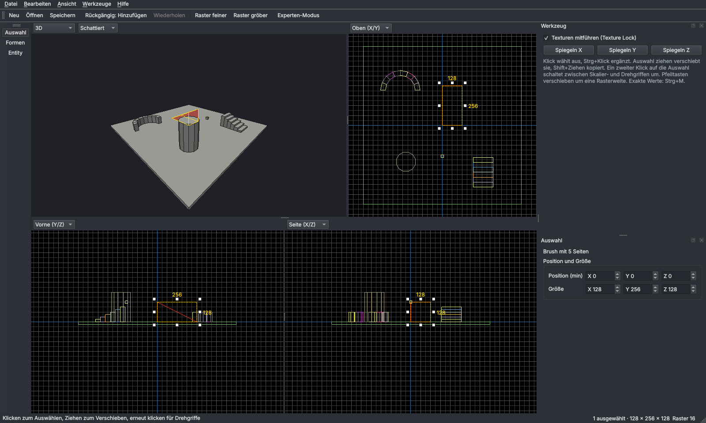

# Rampenschmiede

Desktop-Map-Editor für Windows, spezialisiert auf Surf-, Bhop- und Trick-Maps für
Counter-Strike: Source und Momentum Mod. Ziel: Ein Anfänger baut in 30 Minuten eine
spielbare Surf-Map, ein Profi vermisst keine Funktion aus Hammer.

> **Stand: Etappe 1 von 11** – Fenster, 3D- und 2D-Ansichten, Grundformen, Auswählen,
> Verschieben, Drehen, Skalieren, Undo/Redo, Speichern und Laden als `.rsmap`.
> VMF-Export und Kompilieren folgen in Etappe 2.



## Installation

### Fertige .exe (empfohlen)

Jeder Push baut über GitHub Actions eine Windows-Version:
**Actions → „Tests und Windows-Build“ → letzter Lauf → Artefakt `Rampenschmiede-Windows`**.
ZIP entpacken und `Rampenschmiede.exe` starten. Benötigt eine Grafikkarte mit OpenGL 3.3
(jede GPU der letzten zehn Jahre).

### Aus dem Quellcode

Voraussetzung: Python 3.12.

```powershell
git clone https://github.com/flavyopolo-a11y/rampforger
cd rampforger
py -3.12 -m venv .venv
.venv\Scripts\activate
pip install -e .[dev]
python -m rampenschmiede            # optional: Pfad zu einer .rsmap-Datei
```

Tests: `pytest` · eigene .exe bauen: `python packaging/build_exe.py` (Ergebnis in `dist/Rampenschmiede`).

## Bedienung

Die Steuerung folgt Hammer, damit Umsteiger sich sofort zurechtfinden. **F1** zeigt alle Tasten.

**Ansichten.** Vier Ansichten: 3D, Oben (X/Y), Vorne (Y/Z), Seite (X/Z). Jede lässt sich über
ihre Kopfzeile umstellen, die Trenner sind verschiebbar. Die 3D-Ansicht kennt die Modi
Schattiert, Flach und Drahtgitter.

| Kamera | |
| --- | --- |
| Rechte Maustaste halten (3D) | Umsehen, dazu W A S D fliegen, Q/E runter/hoch, Shift schneller |
| Z (3D) | Umsehen ein/aus |
| Mausrad | 3D: vor/zurück · 2D: zoomen zum Mauszeiger |
| Mittlere Maustaste oder Leertaste + Ziehen | Ansicht verschieben |
| Strg+E | alle Ansichten auf die Auswahl zentrieren |

**Formen bauen (Shift+B).** Form wählen (Block, Keil, Zylinder, Bogen, Treppe), in einer
2D-Ansicht einen Rahmen aufziehen, in einer zweiten Ansicht die Höhe anpassen, **Enter**.
Schneller: in der 3D-Ansicht auf eine Fläche klicken, der Rahmen sitzt dann direkt darauf.

**Auswählen und Bearbeiten (Shift+S).** Klick wählt aus, Strg+Klick ergänzt, Ziehen auf
leerer Fläche zieht einen Auswahlrahmen auf. Auswahl ziehen verschiebt am Raster, Shift+Ziehen
kopiert. Die weißen Griffe skalieren; ein zweiter Klick auf die Auswahl schaltet auf Drehgriffe
(15°-Schritte, mit Shift frei). Pfeiltasten verschieben um eine Rasterweite.
Exakte Zahlen: Panel „Auswahl“ oder **Strg+M** (Transformieren).

**Entities (Shift+E).** Spawns (CT, T, Momentum), Punkt-, Spot- und Sonnenlicht sowie Cubemaps
setzen. Eigenschaften im Panel „Auswahl“ bearbeiten.

| Weitere Tasten | |
| --- | --- |
| [ / ] | Raster feiner / gröber (1 bis 512) |
| Strg+Z / Strg+Y | Rückgängig / Wiederholen (unbegrenzt) |
| Strg+C / Strg+V / Strg+X / Entf | Kopieren / Einfügen / Ausschneiden / Löschen |
| Strg+L / Strg+I | Spiegeln horizontal / vertikal |
| H / Strg+H / U | Auswahl ausblenden / Rest ausblenden / alles einblenden |
| Strg+S | Speichern als `.rsmap` |

## Dokumentation

- [Architektur](docs/architektur.md)
- [Entscheidungslog](docs/entscheidungen.md)

## Bekannte Grenzen (Etappe 1)

- Noch kein VMF-Export und kein Kompilieren (Etappe 2). Maps lassen sich nur als `.rsmap` speichern.
- Keine Texturen in der Ansicht: Flächen werden je Material einfarbig dargestellt (Etappe 4).
- Entities nur aus einer festen Liste, Lichter ohne Vorschau (Etappe 5 und 6).
- Bei beliebigen Drehwinkeln liegen die Ebenenpunkte auf ganzen Units, einzelne Eckpunkte
  können aber krumm werden (siehe E11). Bei 90°-Schritten und allen Grundformen bleibt alles ganzzahlig.
- Beim Laden sehr großer Maps (10'000 Brushes) dauert der erste Aufbau etwa 3 Sekunden;
  das Feintuning dafür ist Teil von Etappe 11.
- Kopieren per Shift+Ziehen ergibt zwei Undo-Schritte (Kopieren, Verschieben).
- Getestet unter Linux mit Software-OpenGL; der Praxistest auf Windows steht noch aus.
